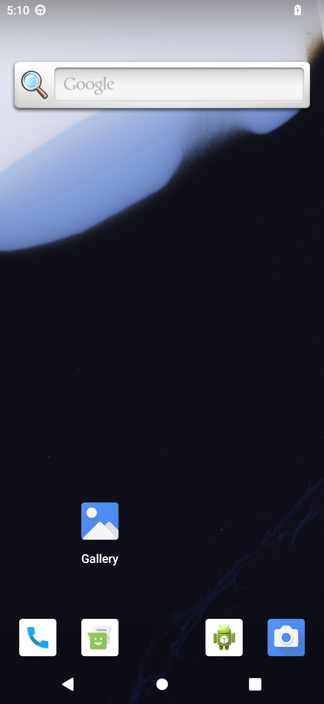

# VirtualAndroid

**Full Android 13 running inside an iOS app.** VirtualAndroid is an Android
emulator for iPhone and iPad: a complete AOSP Android 13 (API 33, arm64) system
with its own Linux kernel, emulated with QEMU inside a normal iOS app, with
GPU-accelerated graphics and the phone's sensors, camera, location, audio and
network bridged into Android.

[简体中文](README.zh-CN.md)

<p align="center">
  
</p>

> Research project. It boots to the Android home screen and runs third-party
> apps on a real iPhone, but it is not a finished product. It cannot be
> distributed through the App Store; you build and sideload it yourself.

## Highlights

- **The real thing, unmodified.** The official AOSP emulator image
  (`system-images;android-33;default;arm64-v8a`) is used as is: kernel,
  system and vendor are not patched.
- **Whole-system emulation in-process.** QEMU 10 (UTM fork) is built as a
  framework and runs on a thread of the app, with the Android emulator's
  `ranchu` board (goldfish pipe, sync, battery, address space; virtio disks,
  input, sound, network).
- **GPU rendering.** Guest OpenGL ES goes through the goldfish pipe to the
  gfxstream host renderer, which draws with ANGLE on Metal into IOSurfaces
  shown by a `CAMetalLayer` (zero-copy, GLES 3.0).
- **Fast without JIT.** Stock iOS apps cannot generate code. On a device
  without JIT the engine runs UTM's TCTI threaded interpreter plus our
  **AOT translation cache**: about 260,000 of the hottest guest code blocks,
  translated offline to C, compiled into the app and matched at runtime by
  content hash (2.3-3.4x faster than plain TCTI).
- **Optional JIT via StikDebug** (on by default). Opened through
  [StikDebug](https://stikdebug.org), the app switches to QEMU's real JIT,
  including on iOS 26/27 devices with TXM. Apps start about twice as fast as
  with TCTI + AOT.
- **Seconds to resume.** Leaving the app suspends the VM into a snapshot
  (guest RAM lives in a file, so only device and renderer state is written);
  reopening it restores the running Android in seconds instead of booting.
- **Android hardware bridged to iOS**: multi-touch and keys, accelerometer,
  gyroscope, magnetometer and barometer (Core Motion), GPS (Core Location),
  camera preview and photos (AVFoundation), speaker and microphone, clipboard,
  battery, Wi-Fi with internet access (virtual access point plus NAT), and a
  virtual Bluetooth controller. adb over vsock for development.

## Status

Measured on an iPhone 17 Pro Max (A19 Pro, iOS 27.2) with a 2 GB, 4-vCPU guest:

| | JIT (StikDebug) | TCTI + AOT cache |
|---|---|---|
| Cold boot to `sys.boot_completed` | ~85 s ¹ | ~433 s |
| Resume from snapshot | seconds ¹ | ~4 s |
| Settings / Clock / Calendar / Dialer cold start | 0.9-1.6 s | 1.6-2.5 s |
| Xiaohongshu cold start | 13.6 s | 26.7 s |
| CoolApk cold start | 16.8 s | 35.4 s |
| Settings scrolling, janky frames | 1.9 % | 3.5 % |

¹ After the debugger has prepared the JIT memory. With StikDebug that step is
not timed yet; the lldb stand-in used for these runs took about 3.5 minutes
for the 512 MB code buffer (one page per round trip; StikDebug batches 128).

Details and methodology: [docs/JIT.md](docs/JIT.md), [docs/AOT.md](docs/AOT.md).

Works: boot, launcher, system apps, installing and running third-party apps,
touch, keyboard, rotation, sensors, GPS, camera, audio in and out, clipboard,
Wi-Fi internet, snapshots. Known limits: the guest has 2 GB of RAM (big apps
lean on the 1 GB zram swap); no Google Play services (AOSP image); Bluetooth
has no real radio; no vibration, light or proximity sensor; without JIT, apps
whose code is not in the AOT cache are slow.

## How it works

```
┌──────────── iOS app (SwiftUI) ─────────────────────────────────────────┐
│ VMController ── Metal display (CAMetalLayer) ── touch/keys → virtio-input │
│ Host bridges: CoreMotion, CoreLocation, AVFoundation, audio, UIDevice    │
│               battery, UIPasteboard                                      │
├──────────── va_host.h (C interface between engine and platform) ───────┤
│ QEMU 10 (UTM fork) as a framework, running on its own thread            │
│  machine "ranchu" = virt + goldfish {pipe, sync, battery, events},      │
│                     goldfish address space                              │
│  virtio: blk ×5, net, rng, console, multitouch, keyboard, sound, vsock   │
│  pipe services: qemud (boot properties, sensors, GPS, camera, …),        │
│                 opengles, clipboard, adb                                │
│  CPU: TCG JIT (simulator, StikDebug) or TCTI + AOT cache (device)        │
├──────────── va_gfx.h ──────────────────────────────────────────────────┤
│ libva_gfx: gfxstream host renderer → ANGLE (Metal) / MoltenVK → IOSurface │
└──────────────────────────────────────────────────────────────────────────┘
Guest: the official AOSP Android 13 emulator image, unmodified
```

| Path | Contents |
|---|---|
| `app/` | The iOS app (SwiftUI, Metal display, host bridges, VM lifecycle, snapshots) |
| `host/include/va_host.h` | Engine ↔ platform interface (callbacks for sensors, camera, audio, …) |
| `gfx/` | `libva_gfx`: gfxstream + ANGLE + MoltenVK build, renderer glue, tests |
| `engine/scripts/ios/` | Cross-compiling QEMU and its dependencies for iOS, AOT cache build |
| `tools/aot/` | AOT translation cache: profiler plugin, TCG-to-C translator, runtime, tests |
| `tools/jit/` | JIT test helpers (lldb stand-in for StikDebug, benchmarks) |
| `tools/` | Image and initrd preparation, macOS run script, snapshot tool |
| `third_party/ref-emu/` | Reference sources from the Android emulator (kept under their own licenses) |
| `docs/` | Design notes and measurements |

The QEMU fork (the `ranchu` board, goldfish devices, pipe services, AOT
runtime, iOS JIT support) lives in its own repository and is checked out at
`engine/qemu`.

## Building

You need an Apple Silicon Mac with Xcode 26.1 or later, and an iPhone or iPad
on iOS 17 or later with enough memory: the app needs about 4 GB (2 GB guest,
code buffer, renderer). It has only been tested on an iPhone 17 Pro Max
(12 GB); devices with less than 8 GB of RAM will probably not fit it. A
**paid Apple Developer account** is required for the
`increased-memory-limit` and `extended-virtual-addressing` entitlements.

```sh
brew install meson ninja pkg-config bison glib e2fsprogs xcodegen

# Sources (the engine and some build inputs are separate checkouts)
git clone <this repository> VirtualAndroid && cd VirtualAndroid
git clone <engine repository> engine/qemu      # the QEMU fork, see above
engine/scripts/ios/fetch_deps.sh              # UTM recipe + dependency tarballs
gfx/scripts/fetch-sources.sh                  # gfxstream, aemu, ANGLE (pinned)

# Engine: dependencies, then the JIT and the no-JIT (TCTI) builds of QEMU
S=engine/scripts/ios
$S/build_deps.sh -p ios
$S/build_qemu.sh -p ios -b tcg  -s engine/qemu
$S/build_qemu.sh -p ios -b tcti -s engine/qemu
$S/make_xcframeworks.sh --device-backend tcg+tcti

# Renderer
for P in ios-sim ios; do
  gfx/scripts/build-aemu.sh $P && gfx/scripts/build-gfxstream.sh $P &&
  gfx/scripts/build-angle.sh $P && gfx/libva_gfx/build.sh $P &&
  gfx/scripts/package-apple.sh $P
done
gfx/scripts/package-apple.sh xcframework

# Android image: the AOSP emulator image from the Android SDK
sdkmanager "system-images;android-33;default;arm64-v8a"
mkdir -p images/android-33
cp -R "$ANDROID_HOME/system-images/android-33/default/arm64-v8a" images/android-33/
app/scripts/make_userdata_qcow2.sh --pack     # -> app/build/ImagePack

# App: set DEVELOPMENT_TEAM in app/project.yml first
cd app && xcodegen generate && cd ..
xcodebuild -project app/VirtualAndroid.xcodeproj -scheme VirtualAndroid \
  -sdk iphoneos -destination 'generic/platform=iOS' \
  -derivedDataPath app/build/dd-device -allowProvisioningUpdates build
xcrun devicectl device install app --device <device> \
  app/build/dd-device/Build/Products/Debug-iphoneos/VirtualAndroid.app
```

Then copy the `app/build/ImagePack` folder into the app's Documents as
`ImagePack` (Finder file sharing or the Files app, or "Import image pack
folder…" in the app). The first launch installs it and boots Android.

The AOT cache is optional and built from profiled runs of your exact engine
build; without it the TCTI engine runs uncached. See
[docs/AOT.md](docs/AOT.md) and `engine/scripts/ios/build_aot.sh`. For the iOS
simulator, build the `ios_simulator` platform and the `ios-sim` renderer
instead; the simulator always has JIT. More detail in
[engine/scripts/ios/README.md](engine/scripts/ios/README.md),
[gfx/README.md](gfx/README.md) and [app/README.md](app/README.md).

## Enabling JIT with StikDebug

1. Install [StikDebug](https://stikdebug.org) and LocalDevVPN, create a
   pairing file (StikDebug can pair on the device itself on iOS 27), turn on
   LocalDevVPN and let StikDebug mount the developer disk image.
2. Either open VirtualAndroid from the home screen: it asks StikDebug to
   attach (confirm "Enable JIT?") and boots with JIT once StikDebug switches
   back. Or, in StikDebug, assign the `universal.js` script to VirtualAndroid
   and launch it from there.
3. The start screen shows which engine this launch uses. Without a debugger
   the app falls back to TCTI + AOT; both use the same snapshot.

On iOS 26+ devices with TXM the debugger has to prepare the JIT memory while
QEMU allocates it; the engine speaks StikDebug's protocol for that and then
detaches the debugger. See [docs/JIT.md](docs/JIT.md).

## Documentation

- [docs/PLAN.md](docs/PLAN.md): goals, constraints, architecture, milestones (Chinese)
- [docs/JIT.md](docs/JIT.md): JIT on the iPhone with StikDebug
- [docs/AOT.md](docs/AOT.md): the AOT translation cache
- [docs/SNAPSHOT.md](docs/SNAPSHOT.md): fast resume (Chinese)
- [app/README.md](app/README.md): the app, launch arguments, image packs

## Acknowledgements

Built on [QEMU](https://www.qemu.org), [UTM](https://github.com/utmapp/UTM)
(its QEMU fork, iOS build recipe and TCTI interpreter), the
[Android Emulator](https://android.googlesource.com/platform/external/qemu/)
(ranchu board and goldfish devices, used as reference), gfxstream and aemu,
[ANGLE](https://chromium.googlesource.com/angle/angle),
[MoltenVK](https://github.com/KhronosGroup/MoltenVK) and
[StikDebug](https://github.com/StephenDev0/StikDebug).

## License

See [LICENSE](LICENSE). Third-party code keeps its own license: QEMU and the
engine fork are GPL-2.0; the Android emulator reference sources in
`third_party/ref-emu` are Apache-2.0 or GPL-2.0 as marked in each file (the few
unmarked ones come from AOSP, Apache-2.0);
gfxstream, aemu, ANGLE and MoltenVK are fetched at build time under their own
licenses. The Android system image is not included; it comes from the Android
SDK under Google's terms.

Android is a trademark of Google LLC. This project is not affiliated with
Google or Apple.
