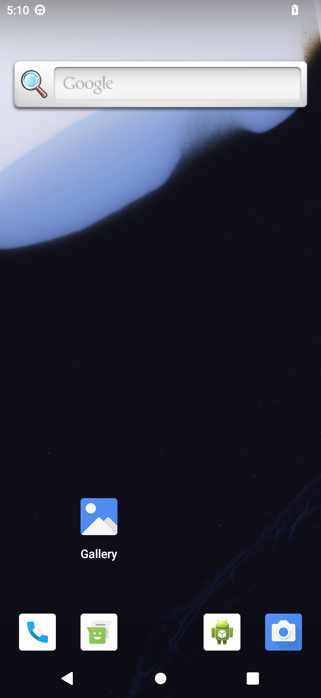

# VirtualAndroid

**在 iOS App 里运行完整的 Android 13。** VirtualAndroid 是一个运行在 iPhone 和 iPad
上的安卓模拟器：一套带自己 Linux 内核的 AOSP Android 13（API 33，arm64）完整系统，
用 QEMU 在普通 iOS App 里整机模拟，图形走 GPU 加速，手机的传感器、相机、定位、
音频和网络都桥接进 Android。

[English](README.md)

<p align="center">
  
</p>

> 这是研究性项目。它能在真 iPhone 上进入 Android 桌面并运行第三方应用，但还不是成品。
> 这类 App 不能上架 App Store，需要自己编译、自己签名安装。

## 特点

- **原版系统，不做修改。** 直接使用官方 AOSP 模拟器镜像
  （`system-images;android-33;default;arm64-v8a`），内核、system、vendor 都不打补丁。
- **App 进程内整机模拟。** QEMU 10（UTM 分支）编成 framework，在 App 的一个线程里运行，
  主板是 Android 官方模拟器的 `ranchu`（goldfish pipe、sync、battery、address space，
  以及 virtio 磁盘、输入、声音、网络）。
- **GPU 渲染。** 客户机的 OpenGL ES 经 goldfish pipe 送到 gfxstream 宿主渲染器，
  由 ANGLE 在 Metal 上绘制到 IOSurface，再由 `CAMetalLayer` 显示（零拷贝，GLES 3.0）。
- **没有 JIT 也够快。** 普通 iOS App 不能动态生成代码。没有 JIT 时引擎使用 UTM 的 TCTI
  线程化解释器，加上我们的 **AOT 翻译缓存**：约 26 万个最热的客户机代码块离线翻译成 C、
  编进 App，运行时按内容哈希命中（比单纯 TCTI 快 2.3～3.4 倍）。
- **可选 JIT（默认开启），借助 StikDebug。** 通过 [StikDebug](https://stikdebug.org)
  打开时，App 切换到 QEMU 真正的 JIT，在带 TXM 的 iOS 26/27 设备上同样可用。
  应用启动速度约为 TCTI + AOT 的 2 倍。
- **秒级恢复。** 离开 App 时把虚拟机挂起成快照（客户机内存本身就在文件里，只需写设备和
  渲染器状态）；再次打开时几秒内回到运行中的 Android，不用重新开机。
- **Android 硬件桥接到 iOS**：多点触控和按键，加速度计、陀螺仪、磁力计、气压计
  （Core Motion），GPS（Core Location），相机预览和拍照（AVFoundation），扬声器和麦克风，
  剪贴板，电池，可上网的 Wi-Fi（虚拟热点 + NAT），以及一个虚拟蓝牙控制器。
  开发时可通过 vsock 使用 adb。

## 现状

iPhone 17 Pro Max（A19 Pro，iOS 27.2）实测，客户机 2 GB 内存、4 个 vCPU：

| | JIT（StikDebug） | TCTI + AOT 缓存 |
|---|---|---|
| 冷启动到 `sys.boot_completed` | 约 85 s ¹ | 约 433 s |
| 从快照恢复 | 数秒 ¹ | 约 4 s |
| 设置 / 时钟 / 日历 / 拨号 冷启动 | 0.9～1.6 s | 1.6～2.5 s |
| 小红书 冷启动 | 13.6 s | 26.7 s |
| 酷安 冷启动 | 16.8 s | 35.4 s |
| 设置列表滑动卡顿帧 | 1.9 % | 3.5 % |

¹ 不含调试器准备 JIT 内存的时间。这一步用 StikDebug 的耗时还没测；这组数据用的是
Mac 上的 lldb 替身，它准备 512 MB 代码缓冲约需 3.5 分钟（每页一次往返，StikDebug 每批 128 页）。

详细数据和测试方法见 [docs/JIT.md](docs/JIT.md)、[docs/AOT.md](docs/AOT.md)。

已经可用：开机、桌面、系统应用、安装并运行第三方应用、触控、键盘、旋转、传感器、GPS、
相机、声音输入输出、剪贴板、Wi-Fi 上网、快照。已知限制：客户机只有 2 GB 内存
（大应用要靠 1 GB 的 zram 交换区）；没有 Google Play 服务（AOSP 镜像）；蓝牙没有真实射频；
没有振动、光线和接近传感器；没有 JIT 时，不在 AOT 缓存里的应用代码运行较慢。

## 原理

```
┌──────────── iOS App（SwiftUI）────────────────────────────────────────────┐
│ VMController ── Metal 显示（CAMetalLayer）── 触控/按键 → virtio-input       │
│ 宿主桥接：CoreMotion、CoreLocation、AVFoundation、音频、UIDevice 电池、     │
│           UIPasteboard                                                     │
├──────────── va_host.h（引擎与平台之间的 C 接口）─────────────────────────────┤
│ QEMU 10（UTM 分支），以 framework 形式在独立线程运行                        │
│  主板 "ranchu" = virt + goldfish {pipe, sync, battery, events}、           │
│                  goldfish address space                                   │
│  virtio：blk ×5、net、rng、console、多点触控、键盘、声音、vsock            │
│  pipe 服务：qemud（启动属性、传感器、GPS、相机……）、opengles、剪贴板、adb  │
│  CPU：TCG JIT（模拟器、StikDebug）或 TCTI + AOT 缓存（真机）               │
├──────────── va_gfx.h ──────────────────────────────────────────────────────┤
│ libva_gfx：gfxstream 宿主渲染器 → ANGLE（Metal）/ MoltenVK → IOSurface      │
└────────────────────────────────────────────────────────────────────────────┘
客户机：官方 AOSP Android 13 模拟器镜像，原样使用
```

| 路径 | 内容 |
|---|---|
| `app/` | iOS App（SwiftUI、Metal 显示、硬件桥接、虚拟机生命周期、快照） |
| `host/include/va_host.h` | 引擎与平台的接口（传感器、相机、音频等回调） |
| `gfx/` | `libva_gfx`：gfxstream + ANGLE + MoltenVK 的构建、渲染器胶水层、测试 |
| `engine/scripts/ios/` | 为 iOS 交叉编译 QEMU 及其依赖，构建 AOT 缓存 |
| `tools/aot/` | AOT 翻译缓存：性能采样插件、TCG 转 C 翻译器、运行时、测试 |
| `tools/jit/` | JIT 测试工具（代替 StikDebug 的 lldb 脚本、跑分脚本） |
| `tools/` | 镜像和 initrd 准备、macOS 运行脚本、快照工具 |
| `third_party/ref-emu/` | Android 官方模拟器的参考源码（保留各自的许可证） |
| `docs/` | 设计说明和测试数据 |

QEMU 分支（`ranchu` 主板、goldfish 设备、pipe 服务、AOT 运行时、iOS JIT 支持）
放在单独的仓库里，检出到 `engine/qemu`。

## 编译

需要一台装有 Xcode 26.1 或更新版本的 Apple Silicon Mac，以及一台 iOS 17 以上、
内存足够的 iPhone 或 iPad：App 需要约 4 GB（2 GB 客户机、代码缓冲、渲染器）。
目前只在 iPhone 17 Pro Max（12 GB）上测过，内存小于 8 GB 的设备大概率不够。
`increased-memory-limit` 和 `extended-virtual-addressing` 两个权限需要**付费的
Apple 开发者账号**。

```sh
brew install meson ninja pkg-config bison glib e2fsprogs xcodegen

# 源码（引擎和部分构建输入是单独检出的）
git clone <本仓库> VirtualAndroid && cd VirtualAndroid
git clone <引擎仓库> engine/qemu               # 即上面说的 QEMU 分支
engine/scripts/ios/fetch_deps.sh              # UTM 构建配方 + 依赖源码包
gfx/scripts/fetch-sources.sh                  # gfxstream、aemu、ANGLE（固定版本）

# 引擎：先编依赖，再编 QEMU 的 JIT 版和无 JIT（TCTI）版
S=engine/scripts/ios
$S/build_deps.sh -p ios
$S/build_qemu.sh -p ios -b tcg  -s engine/qemu
$S/build_qemu.sh -p ios -b tcti -s engine/qemu
$S/make_xcframeworks.sh --device-backend tcg+tcti

# 渲染器
for P in ios-sim ios; do
  gfx/scripts/build-aemu.sh $P && gfx/scripts/build-gfxstream.sh $P &&
  gfx/scripts/build-angle.sh $P && gfx/libva_gfx/build.sh $P &&
  gfx/scripts/package-apple.sh $P
done
gfx/scripts/package-apple.sh xcframework

# Android 镜像：Android SDK 里的 AOSP 模拟器镜像
sdkmanager "system-images;android-33;default;arm64-v8a"
mkdir -p images/android-33
cp -R "$ANDROID_HOME/system-images/android-33/default/arm64-v8a" images/android-33/
app/scripts/make_userdata_qcow2.sh --pack     # 生成 app/build/ImagePack

# App：先在 app/project.yml 里填好 DEVELOPMENT_TEAM
cd app && xcodegen generate && cd ..
xcodebuild -project app/VirtualAndroid.xcodeproj -scheme VirtualAndroid \
  -sdk iphoneos -destination 'generic/platform=iOS' \
  -derivedDataPath app/build/dd-device -allowProvisioningUpdates build
xcrun devicectl device install app --device <设备> \
  app/build/dd-device/Build/Products/Debug-iphoneos/VirtualAndroid.app
```

然后把 `app/build/ImagePack` 文件夹以 `ImagePack` 为名拷进 App 的“文稿”目录
（访达的文件共享或“文件”App，也可以在 App 里用“Import image pack folder…”）。
首次启动会自动安装镜像并开机。

AOT 缓存是可选的，需要用你编出的那个引擎版本跑采样再生成；没有它时 TCTI 引擎不带缓存运行。
见 [docs/AOT.md](docs/AOT.md) 和 `engine/scripts/ios/build_aot.sh`。在 iOS 模拟器上运行时，
改为编 `ios_simulator` 平台和 `ios-sim` 渲染器即可，模拟器总是有 JIT。更多细节见
[engine/scripts/ios/README.md](engine/scripts/ios/README.md)、[gfx/README.md](gfx/README.md)
和 [app/README.md](app/README.md)。

## 用 StikDebug 开启 JIT

1. 安装 [StikDebug](https://stikdebug.org) 和 LocalDevVPN，生成配对文件（iOS 27 上
   StikDebug 可以在手机上直接配对），打开 LocalDevVPN，等 StikDebug 挂载好开发者磁盘映像。
2. 从主屏幕打开 VirtualAndroid：它会请求 StikDebug 附加（在“Enable JIT?”里确认），
   StikDebug 切回来后就用 JIT 启动。也可以在 StikDebug 里给 VirtualAndroid 指定
   `universal.js` 脚本，再从 StikDebug 启动它。
3. 开始界面会显示这次用的是哪个引擎。没有调试器时自动退回 TCTI + AOT，两者共用同一个快照。

在带 TXM 的 iOS 26 以上设备上，QEMU 分配 JIT 内存时调试器必须在场并把这块内存准备好；
引擎实现了 StikDebug 的这套协议，准备完再让调试器分离。详见 [docs/JIT.md](docs/JIT.md)。

## 文档

- [docs/PLAN.md](docs/PLAN.md)：目标、约束、架构、里程碑
- [docs/JIT.md](docs/JIT.md)：用 StikDebug 在 iPhone 上开 JIT（英文）
- [docs/AOT.md](docs/AOT.md)：AOT 翻译缓存（英文）
- [docs/SNAPSHOT.md](docs/SNAPSHOT.md)：快照秒开
- [app/README.md](app/README.md)：App、启动参数、镜像包（英文）

## 致谢

本项目基于 [QEMU](https://www.qemu.org)、[UTM](https://github.com/utmapp/UTM)
（它的 QEMU 分支、iOS 构建配方和 TCTI 解释器）、
[Android 官方模拟器](https://android.googlesource.com/platform/external/qemu/)
（ranchu 主板和 goldfish 设备，作为参考）、gfxstream 和 aemu、
[ANGLE](https://chromium.googlesource.com/angle/angle)、
[MoltenVK](https://github.com/KhronosGroup/MoltenVK) 以及
[StikDebug](https://github.com/StephenDev0/StikDebug)。

## 许可证

见 [LICENSE](LICENSE)。第三方代码保留各自的许可证：QEMU 及引擎分支为 GPL-2.0；
`third_party/ref-emu` 里的 Android 模拟器参考源码按各文件标注为 Apache-2.0 或 GPL-2.0
（少数没有标注的来自 AOSP，为 Apache-2.0）；
gfxstream、aemu、ANGLE、MoltenVK 在构建时下载，适用各自的许可证。
本仓库不包含 Android 系统镜像，它来自 Android SDK，适用 Google 的条款。

Android 是 Google LLC 的商标。本项目与 Google、Apple 无关。
